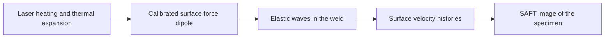

# Laser Ultrasonic NDT COMSOL Models Analysed with SAFT

This project studies how a short laser pulse generates elastic waves in steel,
how those waves interact with a weld and a lack-of-fusion defect, and how the
recorded surface velocities can be used to form an image of the defect.

**[Read the full paper](paper/paper.pdf)** for the equations, modelling assumptions,
comparisons and results.

## Follow the physics



| Step | Scientific question | Where to start |
|---|---|---|
| 1. Laser generation | Can a surface force reproduce the waves generated by local heating? | [Original COMSOL model and calibration workflow](models/laser_generation/README.md) |
| 2. Wave propagation | How do the boundaries and defect scatter longitudinal and shear waves? | [Full and partial weld models](models/README.md) |
| 3. Recordings | What does each surface receiver measure for each laser position? | [Velocity histories](data/README.md) |
| 4. Imaging | Which source-to-point-to-receiver paths focus the defect response? | [SAFT method and use](saft/README.md) |
| 5. Compare results | Do the reconstructed images reproduce the paper? | [Reproduce the results](tools/README.md#reproduce-the-paper) |

## What is included

The **local laser model** contains two studies on the same small steel patch:
heat conduction coupled to thermal expansion, and an elastic calculation with
an equivalent tangential force dipole. Comparing their outgoing waves gives
the source strength used in the larger weld simulations. The original `.mph`
file, model-building and solving scripts, and waveform comparison are included.

The **weld models** describe a full weld and a partially filled J-bevel weld
with 9 mm fill, each with a sound and a lack-of-fusion case. The supplied
recordings cover five laser positions per specimen and 0-50 microseconds of
propagation. They allow imaging without running COMSOL again.

The **SAFT analysis** adds the recorded signals at the predicted travel times
through each candidate image point. It supports longitudinal and shear waves,
specified reflected paths, source and receiver selection, filtering and
suppression of early unwanted arrivals.

## Reproduce a result

After the one-time [software setup](tools/README.md#software-setup):

```sh
python tools/reproduce_main.py
```

This reconstructs the principal images and compares them with the paper.
The expected lack-of-fusion contrasts are 12.79250 dB for the full weld,
14.44694 dB for the partial weld with early-arrival suppression, and
9.08623 dB for the same partial-weld case without suppression. These are
contrasts for the prescribed simulated defect, rather than detection limits.
New images and numerical results are written under `output/`.

To examine laser generation first, follow the
[local-source guide](models/laser_generation/README.md). It covers opening the
original COMSOL model, repeating the two source calculations and comparing the
included waveforms without a new solve.

## Use a different specimen

Provide its **geometry**, **source and receiver positions**, and **velocity
histories**, then use the same imaging method. The
[data-format guide](saft/FORMAT.md) gives editable examples and the required
units and sampling conventions. Source count, receiver count, specimen outline
and sampling interval can all differ from the weld examples.

The imaging model assumes a homogeneous, isotropic, two-dimensional elastic
material. Polygon boundaries and voids are supported. Heterogeneous refraction,
3D propagation and diffraction are outside its present physics.

## Finding the material

- `models/`: COMSOL specimens, local laser generation and model parameters.
- `data/`: the measured quantities from the simulations: receiver velocities.
- `saft/`: imaging calculations, examples and input definitions.
- `paper/`: the single complete paper, its PDF, figures and numerical supplement.
- `studies/laser/`: reference results and calculations used to reproduce its figures.
- `tools/`: commands for running the analyses and checking the results.
- `tests/` and `verification/`: numerical checks and records of what was verified.

COMSOL 6.4 with the relevant physics licences is needed for fresh finite-element
calculations. Analysis of the supplied recordings does not require COMSOL.
